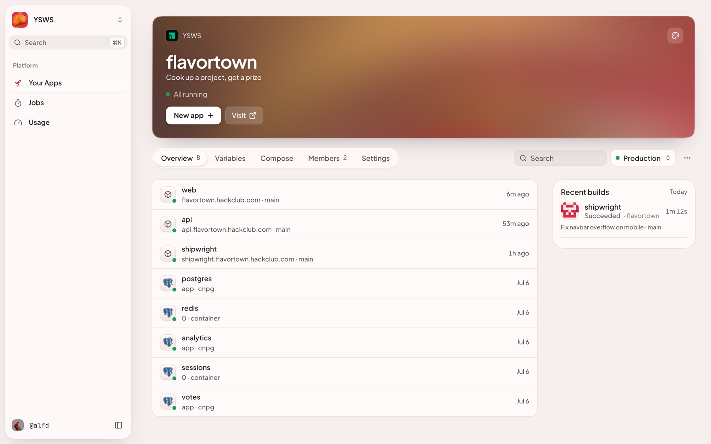
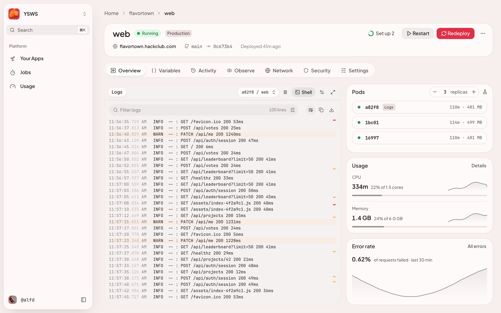
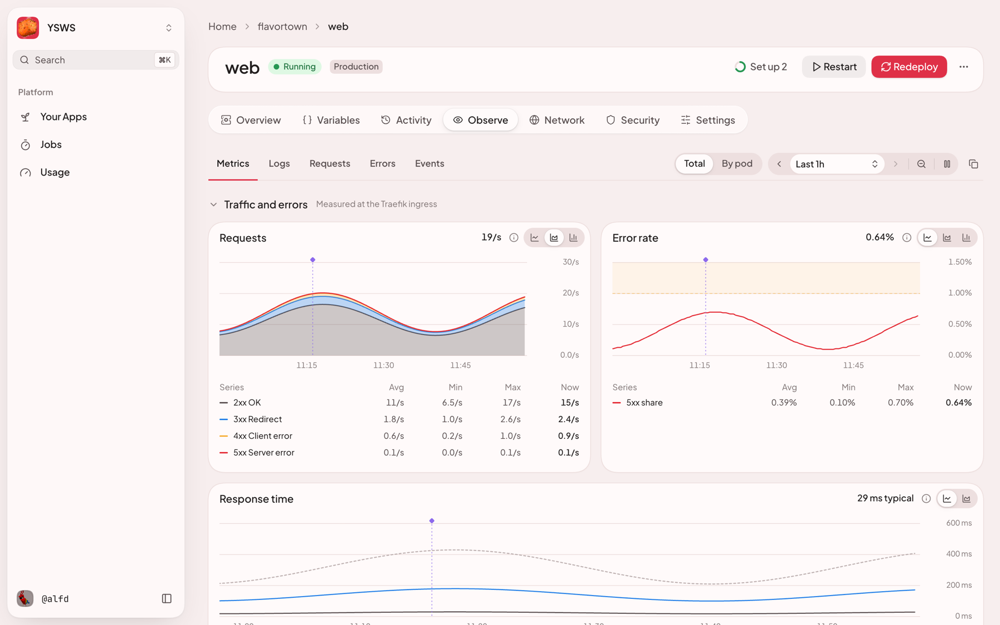
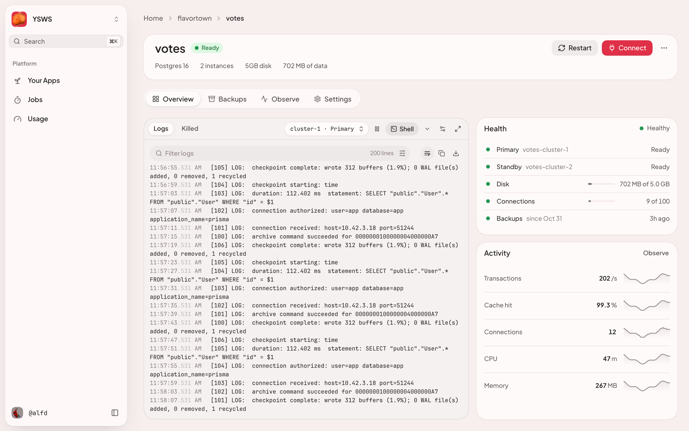

<div align="center">


### Push a repo. Get a running app. On the cluster you already own.

[](https://github.com/hackclub/orchard/actions/workflows/release.yml)
[](LICENSE)
[](https://docs.orchard.my)
[](https://github.com/hackclub/orchard/pkgs/container/orchard%2Fcharts%2Forchard)

[Website](https://orchard.my) ·
[Docs](https://docs.orchard.my) ·
[Install](https://docs.orchard.my/start/install/) ·
[First deploy](https://docs.orchard.my/start/first-deploy/) ·
[Templates](https://orchard.my/templates)

<br>

<picture>
  <source media="(prefers-color-scheme: dark)" srcset=".github/assets/screenshots/project-dark.png">
  
</picture>

</div>

## What is this

Orchard installs into a Kubernetes cluster you own and turns it into something that feels like a
PaaS. Point it at a GitHub repo and it builds the image, runs it, routes traffic to it, hands it a
Postgres database, and shows you the logs when it breaks.

It's similar to Coolify or Dokploy, except it targets Kubernetes. Replicas, rolling updates, health
checks, quotas and node scheduling come from the platform underneath, instead of being rebuilt on
top of Docker. No YAML past the install, and everything it creates is a normal Kubernetes resource
you can still `kubectl get`.

Hack Club runs its own apps on it. Your apps, your data and your builds stay on your hardware, and
usage reporting is off unless an admin opts in.

## Install

On a Linux box with nothing on it:

```bash
sudo bash -c "$(curl -fsSL https://assets.orchard.my/install.sh)"
```

It asks for a domain and an email, then brings its own k3s, Traefik, CloudNativePG, cert-manager,
registry, metrics, log search and image scanner. You need amd64 or arm64, at least 4 GB of RAM (8 GB
is comfortable) and 20 GB of free disk (60 GB once you're building things).

| Mode     | Use it when                                 | HTTPS                                 |
| -------- | ------------------------------------------- | ------------------------------------- |
| `public` | The box has a public IP and free 80 and 443 | Let's Encrypt                         |
| `tunnel` | It's behind NAT, or those ports are taken   | Cloudflare, through Cloudflare Tunnel |
| `lan`    | It's only for your LAN or Tailscale         | Self-signed                           |

Already running Kubernetes? Use the Helm chart instead, because the installer would put k3s
underneath you:

```bash
helm install orchard oci://ghcr.io/hackclub/orchard/charts/orchard \
  --namespace orchard --create-namespace -f my-values.yaml
```

The [install guide](https://docs.orchard.my/start/install/) covers prerequisites, DNS and every flag.

> [!IMPORTANT]
> Deployments are network isolated from each other and from the platform by default, but they
> **share the host kernel** unless you install gVisor or Kata and switch them on. Running untrusted
> code is not safe out of the box. Read
> [Security and isolation](https://docs.orchard.my/operate/security/) before letting strangers deploy
> things.

> [!TIP]
> A fresh install is not a production instance. Secrets, signup mode, TLS cookies, control-plane
> backups and isolation all need a decision from you.
> [Going to production](https://docs.orchard.my/operate/production/) walks through the list.

## What it does

|                |                                                                                                                                                                                                              |
| -------------- | ------------------------------------------------------------------------------------------------------------------------------------------------------------------------------------------------------------ |
| **Deploys**    | GitHub repos, container images and Compose stacks, built on your cluster, with logs as they happen, and rollback                                                                                             |
| **Routing**    | An HTTPS URL per app, custom domains with certificates that renew themselves, and an auth wall if you want one                                                                                               |
| **Data**       | Managed Postgres with backups, point-in-time restore, forks, extensions, read replicas and a query console                                                                                                   |
| **Jobs**       | Cron schedules and multi-step pipelines, with per-step output and exit codes                                                                                                                                 |
| **Observe**    | Log search, per-route request stats, CPU and memory over time, and the logs of containers that already died                                                                                                  |
| **Security**   | Image vulnerability scanning and config checks per app                                                                                                                                                       |
| **Teams**      | Organizations, projects, roles, SSO, SCIM provisioning, audit logs and quotas                                                                                                                                |
| **Templates**  | 90+ apps you can deploy from the [template gallery](https://orchard.my/templates)                                                                                                                            |
| **Extensions** | Add pages, API routes and MCP tools with [grafts](https://docs.orchard.my/grafts/install/)                                                                                                                   |
| **Interfaces** | A web dashboard, a [CLI](https://docs.orchard.my/reference/cli/), an [API](https://docs.orchard.my/api/), an OpenTofu provider, and an [MCP server](https://docs.orchard.my/mcp/) so your agent can drive it |

<table>
  <tr>
    <td width="50%">
      <picture>
        <source media="(prefers-color-scheme: dark)" srcset=".github/assets/screenshots/deployment-dark.png">
        
      </picture>
    </td>
    <td width="50%">
      <picture>
        <source media="(prefers-color-scheme: dark)" srcset=".github/assets/screenshots/observe-dark.png">
        
      </picture>
    </td>
  </tr>
  <tr>
    <td width="50%">
      <picture>
        <source media="(prefers-color-scheme: dark)" srcset=".github/assets/screenshots/database-dark.png">
        
      </picture>
    </td>
    <td width="50%" valign="top">
      <br>

```console
$ orchard up
$ orchard logs <id> -f
$ orchard deploy scale <id> 3
$ orchard deploy rollback <id>
```

The dashboard, CLI and MCP server all speak the same API.

</td>
  </tr>
</table>

## Contributing

Issues and pull requests are welcome. [CONTRIBUTING.md](CONTRIBUTING.md) covers running it locally
and how commits drive releases, and [docs/ARCHITECTURE.md](docs/ARCHITECTURE.md) explains how the
pieces fit together. You don't need a cluster for UI or API work, and `pnpm dev:mock` runs the
dashboard with no backend at all.

## Help

Open an [issue](https://github.com/hackclub/orchard/issues), or find **@lfd** on the
[Hack Club Slack](https://slack.hackclub.com).

## License

[AGPL-3.0](LICENSE). The web app, the API, the gateway, the CLI, all of it. Not an open core with the
good parts held back.

<br>

<div align="center">

A [Hack Club](https://hackclub.com) project, made with <3 by [Leafd](https://github.com/LeafdTK)

</div>
