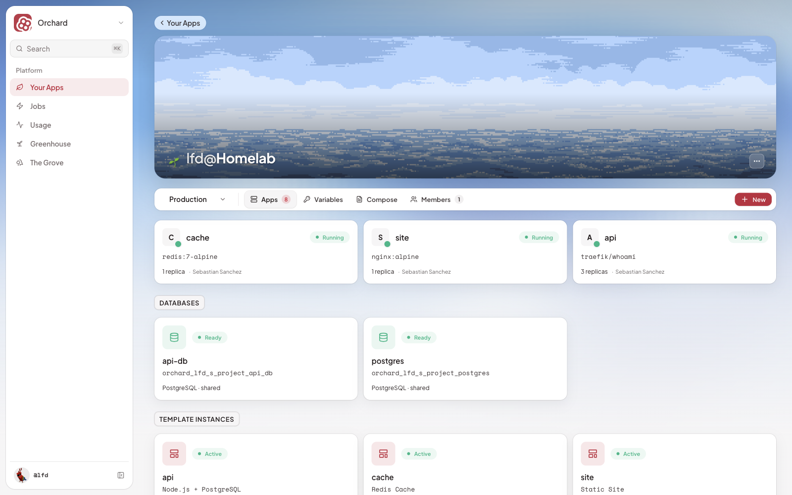

<div align="center">


<br>

# A Hack Club Project created by [Leafd](https://github.com/LeafdTK)

### Push a repo. Get a running app. On the cluster you already own.

<br>

[](https://github.com/LeafdTK/leaf/actions/workflows/release.yml)
[](LICENSE)
[](https://docs.orchard.my)
[](https://github.com/LeafdTK/leaf/pkgs/container/leaf%2Fcharts%2Forchard)

**[Documentation](https://docs.orchard.my)** ·
[Install](https://docs.orchard.my/start/install/) ·
[First deploy](https://docs.orchard.my/start/first-deploy/) ·
[CLI](https://docs.orchard.my/reference/cli/) ·
[API](https://docs.orchard.my/api/) ·
[MCP](https://docs.orchard.my/mcp/)

<br>



</div>

<br>

## What it is

Orchard installs into a Kubernetes cluster **you** control and turns it into
something closer to a PaaS. Connect a GitHub repo and it builds the image, runs
it, routes traffic to it, gives it a Postgres database, and shows you the logs
when it breaks.

Same family as Coolify and Dokploy, except it targets Kubernetes — so replicas,
rolling updates, health checks, quotas and node scheduling come from the platform
underneath instead of being reimplemented on top of Docker.

Nothing phones home. The scheduler is your cluster, the registry is yours, and
the data stays on your hardware.

## What you get

| | |
|---|---|
| **Deploys** | GitHub repos or container images, built on your cluster with streaming logs |
| **Routing** | An HTTPS URL per app, custom domains with automatic certificates, an optional auth wall |
| **Data** | Managed PostgreSQL with backups, extensions, read replicas and a query console |
| **Jobs** | Cron schedules and multi-step pipelines, with per-step output and exit codes |
| **Visibility** | Live logs by pod and time range, CPU and memory over time, and the logs of containers that already died |
| **Teams** | Organizations, projects, roles, SSO, SCIM provisioning, audit logs, quotas |
| **Interfaces** | A web dashboard, a Go CLI, and an MCP server so agents can drive it |

## Install

On a bare Linux box with nothing on it yet:

```bash
curl -fsSL https://raw.githubusercontent.com/leafdtk/leaf/main/install/install.sh | sudo bash
```

It brings its own k3s, Traefik, CloudNativePG, cert-manager and registry.

Already running Kubernetes? Use the Helm chart instead — the installer would try
to put k3s underneath you:

```bash
helm install orchard oci://ghcr.io/leafdtk/leaf/charts/orchard \
  --namespace orchard --create-namespace -f my-values.yaml
```

Full walkthrough, prerequisites and DNS setup:
**[docs.orchard.my/start/install](https://docs.orchard.my/start/install/)**

> [!IMPORTANT]
> Deployments are network-isolated from each other and from the platform by
> default, but they **share the host kernel** unless you install gVisor or Kata
> and enable them. Running untrusted code is not safe without that.
> See [Security and isolation](https://docs.orchard.my/operate/security/).

> [!TIP]
> A fresh install is not a production instance. Secrets, signup mode, TLS
> cookies, control-plane backups and isolation all need deciding first —
> [Going to production](https://docs.orchard.my/operate/production/) walks
> through it.

<details>
<summary><b>Monorepo layout</b></summary>

<br>

```
apps/                  deployable units (one container image each)
  frontend             SvelteKit web app
  server               NestJS API + Prisma
  gateway              Go edge gateway
  r2-proxy             Go R2 storage proxy
  cli                  Go CLI (`orchard`)
  landing              Marketing site
  docs                 Documentation site (Astro Starlight)
packages/              shared, importable code (not deployed)
infra/                 charts/ (Helm) · k8s/ · datadog/
install/               one-command installer
docs/                  design + architecture notes
```

`apps/*` are things you **deploy** — they have a Dockerfile and get released.
`packages/*` are things you **import** — shared code, never deployed.

</details>

<details>
<summary><b>Develop locally</b></summary>

<br>

Prereqs: Node 22+, pnpm 10, Go 1.22+ (1.26 for the CLI), Docker.

```bash
pnpm install
docker compose -f docker-compose.dev.yml up -d    # Postgres 16 + Redis

cp .env.example apps/server/.env                  # defaults boot as-is
cp apps/frontend/.env.example apps/frontend/.env

pnpm --filter server prisma:generate
pnpm --filter server prisma:migrate               # apply migrations
pnpm --filter server prisma:seed                  # demo data

pnpm dev                                          # frontend + server + gateway
```

Open <http://localhost:4000>. The gateway proxies `/apiv1/*` to the API on 3001
and everything else to Vite on 3000 — always use `:4000` or logins break.

The seed gives you `admin@orchard.dev` in the `orchard-demo` org. Sign in with an
email OTP; codes print to the server console when SMTP is unconfigured.

A Kubernetes cluster is **not** required for UI/API development. The server boots
without one and deploy/build features return 503 until you point
`KUBECONFIG_PATH` at a cluster.

Per service:

```bash
pnpm --filter frontend dev
pnpm --filter server dev
pnpm --filter landing dev    # marketing site  :5173
pnpm --filter docs dev       # documentation   :5174
cd apps/cli && go run .
```

Tests:

```bash
pnpm --filter server test:auth-coverage   # route/auth snapshot (no DB needed)
pnpm --filter server test:rbac            # e2e, needs a running server + DB
cd apps/cli && go test ./...
```

</details>

<details>
<summary><b>Documentation that cannot drift</b></summary>

<br>

Every reference page is generated from the code it documents — the OpenAPI
contract, the CLI's own command tree, the MCP tool registry, and `.env.example`:

```bash
pnpm --filter docs generate         # API, CLI, MCP tools, config vars
pnpm --filter docs check:generated  # fails if the output is stale
```

CI runs the check, so a route added without regenerating fails the build rather
than quietly shipping stale docs.

</details>

<details>
<summary><b>Release & CI</b></summary>

<br>

- **PRs** run checks in GitHub Actions, skipping components that didn't change.
- **`main`** runs release-please. Each service is versioned independently
  (`<service>/vX.Y.Z`) from
  [Conventional Commits](https://www.conventionalcommits.org/), and only bumped
  services build and publish their image to GHCR.

See [`docs/ARCHITECTURE.md`](docs/ARCHITECTURE.md) for the service-split roadmap
and [`CONTRIBUTING.md`](CONTRIBUTING.md) for the PR workflow.

</details>

## License

[AGPL-3.0](LICENSE) — the web app, the API, the gateway and the CLI. All of it,
not an open core with the useful parts held back.

<br>

<div align="center">

A <strong>Hack Club</strong> project created by
<a href="https://github.com/LeafdTK"><strong>Leafd</strong></a>

<sub>Built on Kubernetes, by people who got tired of writing YAML.</sub>

</div>
